<!-- Dynamic Typing SVG Header -->

  

  <strong>Systems Engineering • Low-Level Runtimes • Applied AI & Mobile Architecture</strong>

<!-- Social Connect Badges -->

  
  
  
  

<!-- Terminal Profile Card -->

  

---

### 🚀 About Me

- 🎓 **Education:** Pursuing B.Sc. in Computer Science & Engineering at **BRAC University** (Dhaka, Bangladesh • Expected May 2027)
- ⚙️ **Systems & Infrastructure:** Deep focus on low-level performance, Linux syscalls & internals, compilers, graphics pipelines (Vulkan, SPIR-V), and asynchronous runtime design (Rust, C/C++)
- 🤖 **Applied AI & Agentic Systems:** Developing multi-agent architectures, on-device SLMs (`Gemma`, `EmbeddingGemma`, `Qwen`), RAG pipelines, explainable AI (SHAP/LIME), and LLM gateway tooling (`LiteLLM`, `TRL`, `llama.cpp`)
- 📱 **Mobile & Modern Web:** Architecting offline-first mobile systems in **Flutter/Dart** (Riverpod, Isar) and high-throughput web platforms (**Next.js 16**, **React 19**, **FastAPI**, **TypeScript**)
- 🌐 **Upstream Open Source:** Prolific contributor to critical systems software, reverse proxies, eBPF libraries, and translation layers

---

### 🌐 Upstream Open Source Contributions

I actively contribute upstream to production infrastructure, systems software, and developer tooling:

| Repository | Tech Stack | Contribution Highlight |
| :--- | :--- | :--- |
| **[uutils/coreutils](https://github.com/uutils/coreutils)** | `Rust` | Implemented GNU Coreutils 9.12 error-parity diagnostics for cross-device directory fallbacks, delivering a **+20.6% performance speedup** on the `mv_force_overwrite` benchmark (CodSpeed). |
| **[cloudflare/pingora](https://github.com/cloudflare/pingora)** | `Rust` | Authored dynamic retry policies, asynchronous exponential backoff hooks (`retry_backoff`), and per-session attempt tracking for Cloudflare's high-scale proxy framework. |
| **[BerriAI/litellm](https://github.com/BerriAI/litellm)** | `Python` | Co-authored upstream PR #49474 implementing bearer auth forwarding and environment secret expansion across Agent-to-Agent (A2A) hops. |
| **[falcosecurity/libs](https://github.com/falcosecurity/libs)** | `C++` | Preserved layer-4 transport protocols across IPv6-to-IPv4-mapped socket transitions in the Linux kernel security event engine. |
| **[aya-rs/aya](https://github.com/aya-rs/aya)** | `Rust` | Extended pure-Rust eBPF introspection by exposing program section names across all 29 concrete program types. |
| **[vkd3d-proton](https://github.com/HansKristian-Work/vkd3d-proton) / [dxil-spirv](https://github.com/HansKristian-Work/dxil-spirv)** | `C` `C++` | Direct3D 12 to Vulkan translation and SPIR-V compiler fixes (Hull Shader varyings, mesh shader workgroup payloads, barrier scoping). |
| **[huggingface/trl](https://github.com/huggingface/trl)** | `Python` | Handled Qwen3.5 tool-calling reasoning boundary handling in reinforcement learning training pipelines. |

---

### 💼 Featured Projects

| Project | Description | Tech Stack | Repository |
| :--- | :--- | :--- | :--- |
| **[DocFlow](https://github.com/afnan-mojumder/DocFlow)** | Universal local-first document processing platform combining deterministic conversions (PDF, Office, Images, OCR) with zero-API-key local table & entity parsing, WebAssembly tools, and Bubblewrap sandboxing. | `Next.js 16` `React 19` `TypeScript` `FastAPI` `Python 3.12` `Bubblewrap` | [afnan-mojumder/DocFlow](https://github.com/afnan-mojumder/DocFlow) |
| **[DistillEd](https://github.com/Nishmam12/DistillEd)** | Offline-first Flutter notebook and AI study platform featuring an Excalidraw-style canvas, shape recognition, palm rejection, vector/stroke erasing, and local Gemma/EmbeddingGemma on-device models. Verified with **1,380+ tests**. | `Flutter` `Dart` `Gemma` `EmbeddingGemma` `ML Kit` `Riverpod` | [Nishmam12/DistillEd](https://github.com/Nishmam12/DistillEd) |
| **[The Committee (QuantAgent)](https://github.com/sharzilnfz/QuantAgent)** | Multi-agent quantitative paper-trading reference architecture with Alpaca ingestion, point-in-time safeguards (`TemporalGuard`), deterministic offline replay under a 3-second SLA, and fractional-Kelly volatility allocation. | `TypeScript` `Python` `Alpaca API` `PostgreSQL` | [sharzilnfz/QuantAgent](https://github.com/sharzilnfz/QuantAgent) |
| **Explainable AI for IIoT Anomaly Detection** | Reproducible Edge-IIoTset benchmark study comparing deep anomaly detection models, evaluating KernelSHAP/LIME fidelity and coupling with SLMs (Qwen2.5) to synthesize grounded incident triage narratives. | `PyTorch` `SHAP` `LIME` `Qwen2.5-1.5B` `Edge-IIoTset` | *Academic Research* |
| **[Wayfarer](https://github.com/Nishmam12/matha-noshto-game)** | Retro exploration game engine strictly constrained to a 1.44 MB floppy disk with automated build size-gate enforcement, custom RLE sprite compression, and resilient world generation. | `C99` `SDL2` `PowerShell` | [Nishmam12/matha-noshto-game](https://github.com/Nishmam12/matha-noshto-game) |

---

### 🛠️ Tech Stack & Tooling

#### Systems & Languages

#### Frameworks & Modern Runtimes

#### AI / ML & Scientific Computing

#### Databases, Cloud & DevOps

---

### 📊 GitHub Activity & Metrics

  
  
  

  

---

  Engineered with precision by Afnan Mojumder • © 2026

